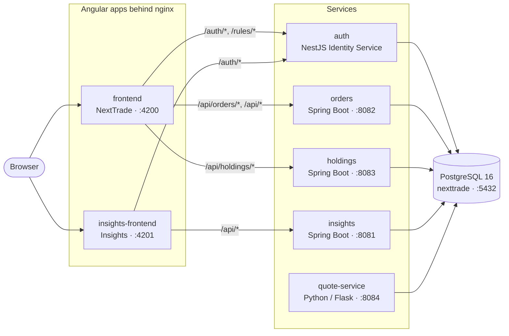
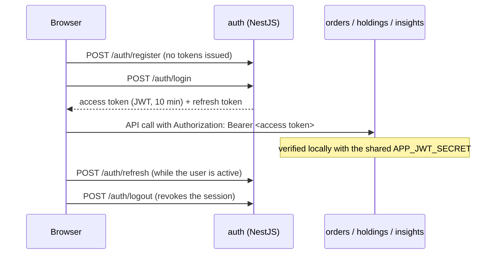

# NextTrade

**Team: Lil Leap**

NextTrade is a trading platform built around two applications: **NextTrade**, the core trading experience, and **NextTrade Insights**, which turns that activity into analytics and reporting. This repository holds the full stack behind both - NextTrade and Insights Spring Boot services, their Angular frontends, a standalone Identity Service, the PostgreSQL schema, a synthetic quote data pipeline, and the Docker/Jenkins automation that ties it all together.

## Team

| Team Member     | Role                              |
| ---------------- | ---------------------------------- |
| Tanush Kaushik   | Technical Lead, Data Engineer      |
| Julia Wiecek     | Developer, Spring Boot (Scrum Master) |
| Kevin Marin      | Developer, Spring Boot             |
| Lalima Karri     | Developer, Angular                 |
| Ilhan Gelle      | Developer, Security                |

## Quick Start

**New to the project?** Start here:

1. **[Getting Started](docs/GETTING_STARTED.md)** - Local environment setup
2. **[Database Setup](docs/DATABASE_SETUP.md)** - PostgreSQL + Docker configuration
3. **[Code Coverage](docs/coverage/README.md)** - How to generate each service's coverage report, and the latest figures
4. **[Jenkins + SonarQube](docs/SONARQUBE_SETUP.md)** - Classroom server, Jenkins credentials, coverage, and Quality Gate setup

**All systems running?** Access the apps:
- NextTrade: http://localhost:4200
- Insights (reporting): http://localhost:4201
- API docs: see [API Documentation](#api-documentation-swagger--openapi)

### Test Logins (Development Only)

A fresh database comes with three ready accounts, so there is no need to register by hand.
They share one password, which is posted in the team's secure chat rather than in this repository
(the seed stores only its bcrypt hash).

| Email | Role | What you get |
| --- | --- | --- |
| `novice@nexttrade.local` | Trader, Novice | Novice dashboard, $10,000 cash, AAPL and MSFT holdings, 3 filled orders and 1 rejected |
| `advanced@nexttrade.local` | Trader, Advanced | Advanced dashboard, $150,000 cash, 5 holdings, 6 filled orders and 1 rejected |
| `analyst@nexttrade.local` | Analyst | Insights (reporting) app |

They come from [`db/seeds/002_test_users.sql`](db/seeds/002_test_users.sql), which uses fixed ids so
tests and docs can refer to the same accounts. It loads automatically:

- **Docker:** on an empty `db_data` volume, as `05-test-users.sql`.
- **No Docker:** every time you run `db/setup-local.sql` (see [QUICKSTART.md](QUICKSTART.md)).

To add them to an existing Docker database without wiping it, run:

```bash
docker compose exec db psql -U main -d nexttrade -f /docker-entrypoint-initdb.d/05-test-users.sql
```

The script is safe to re-run and never changes rows that already exist. If you registered one of
these emails yourself, it stops with a message instead; delete that user or start from an empty volume.
These accounts are for development and demos only and must never be loaded into production.

## 📊 Code Coverage Status

| Service | Coverage | Tests | Goal |
|---|---|---|---|
| Python Data Pipeline | **79.67%** | 72 ✓ | 85% |
| Java Insights | **77.79%** | 320 ✓ | 85% |

👉 **[View detailed coverage reports →](docs/coverage/README.md)**

## Project Structure

```text
lil-leap/
|- auth/                 # NestJS Identity Service: register, login, refresh/logout, password reset,
|                        #   server-assigned trader tier, OpenAPI spec (openapi.json)
|- nextTrade-orders/     # Spring Boot: order submission, execution, settlement, history, cash
|- nextTrade-holdings/   # Spring Boot: holdings service
|- insights/             # Spring Boot: portfolio, order submission, instruments,
|                        #   market data
|- frontend/             # Angular: NextTrade trading app (nginx, :4200)
|- insights-frontend/    # Angular: Insights reporting app (nginx, :4201)
|- data-pipeline/        # Python/Flask quote-service: synthetic quotes -> Postgres
|- kafka/                # Kafka broker image and topic setup
|- db/                   # Schema, migrations, seeds, app-role script, SQL tests, ER diagram
|- docs/                 # api/, coverage/ (generated reports), architecture/ (ADRs), stories/, javadoc/
|- InitialSetup/         # Jenkins setup guide
|- docker-compose.yml    # Runs the whole stack locally
|- Jenkinsfile           # CI: compose validation, tests, coverage, image build
|- env.example           # Environment variables to copy into .env
`- RUN_*.md, README_*.md # Run notes for individual tickets
```

## Architecture



Browsers only talk to the two nginx frontends; each proxies API paths to the
right service on the Docker network, so every call is same-origin (no CORS).
`auth` has no host port at all. Every service connects to Postgres as the
restricted `app_user` role; the schema is owned by the admin role.

| Service | Tech | Host port | What it does today |
|---|---|---|---|
| `auth` | NestJS 10 + TypeORM | none (via nginx) | Registration, login, refresh-token rotation and logout; password reset (reset emails are written as `.eml` files to the `password_reset_outbox` volume, because the VM has no network); assigns the trader tier; `GET /rules/tier-eligibility`. See [auth/README.md](auth/README.md). |
| `orders` | Spring Boot 3.3.4 | 8082 | Order submission, execution against live quotes, atomic settlement of cash and holdings, order history and cash balances; publishes terminal order events to Kafka. |
| `holdings` | Spring Boot 3.3.4 | 8083 | Holdings service. |
| `insights` | Spring Boot 3.3.4 | 8081 | Client financials/portfolio, order submission, instrument lookup, market data. |
| `quote-service` | Python 3.12 + Flask | 8084 | Generates synthetic quotes and ingests them into Postgres continuously. |
| `kafka` | Apache Kafka + ZooKeeper (Confluent 7.5) | 9092, 29092 | Optional event broker; when the Kafka Compose override is enabled, the shared `order-events` topic serves the Orders producer and three Insights consumer groups. See [Kafka Order Events](#kafka-order-events). |
| `db` | PostgreSQL 16 | 5432 | Schema from `db/finalized-schema.sql`, role from `db/init-app-role.sh`. |

### Authentication Flow



The access token carries `sub`, `email`, `client_id` and, for traders,
`trader_level`, which the frontend uses to pick the Novice or Advanced
dashboard. Sessions expire after 10 minutes of inactivity (BR-03).

### Kafka Order Events

Kafka is used for asynchronous reporting of terminal order lifecycle events. The
Orders service publishes one JSON event to the shared `order-events` topic when
an order reaches `FILLED` or `REJECTED`. The Insights service receives that
event through three independent consumer groups:

| Consumer group | Filter | Output |
|---|---|---|
| `insights-completed-trades` | `FILLED` events | `completed-trades.csv` |
| `insights-failed-trades` | `REJECTED` events | `failed-trades.csv` |
| `insights-order-audit` | Every terminal event | `trade-audit.csv` |

The database transaction remains the source of truth for order settlement.
Kafka publication is best-effort after the transaction completes, so a Kafka
failure does not undo a completed order. The broker is development-only and is
started through the optional Compose override:

```bash
docker compose -f docker-compose.yml -f docker-compose.kafka.yml up --build -d kafka kafka-topics orders insights
```

#### Kafka Files and Directories

- [kafka/](kafka/) contains the broker image, topic setup, and Kafka-specific documentation.
- [kafka/Dockerfile](kafka/Dockerfile) builds the Confluent 7.5.0 broker and configures the internal `kafka:9092` listener and loopback host listener `localhost:29092`.
- [kafka/topics/create-topics.sh](kafka/topics/create-topics.sh) waits for the broker and creates `order-events` with one partition and replication factor one.
- [kafka/broker-config/server.properties](kafka/broker-config/server.properties) is a configuration reference; the active Docker settings come from the Dockerfile environment.
- [docker-compose.kafka.yml](docker-compose.kafka.yml) adds ZooKeeper, Kafka, the topic initialization job, Kafka health checks, persistent volumes, and the Orders/Insights Kafka environment variables.
- [nextTrade-orders/pom.xml](nextTrade-orders/pom.xml) adds Spring Kafka to the producer service.
- [nextTrade-orders/src/main/java/com/neueda/leap/order/execution/event/KafkaOrderLifecycleEventPublisher.java](nextTrade-orders/src/main/java/com/neueda/leap/order/execution/event/KafkaOrderLifecycleEventPublisher.java) loads the committed terminal order state, serializes the event, and publishes it using the order ID as the Kafka key.
- [nextTrade-orders/src/main/java/com/neueda/leap/order/execution/event/OrderLifecycleEvent.java](nextTrade-orders/src/main/java/com/neueda/leap/order/execution/event/OrderLifecycleEvent.java) defines the producer's JSON event payload.
- [nextTrade-orders/src/main/java/com/neueda/leap/order/execution/OrderExecutionWorker.java](nextTrade-orders/src/main/java/com/neueda/leap/order/execution/OrderExecutionWorker.java) invokes the publisher after successful terminal execution.
- [nextTrade-orders/src/main/resources/application.yml](nextTrade-orders/src/main/resources/application.yml) configures the producer bootstrap server and the configurable `ORDERS_KAFKA_TOPIC` value.
- [insights/pom.xml](insights/pom.xml) adds Spring Kafka to the consumer service.
- [insights/src/main/java/com/neueda/leap/reporting/kafka/KafkaOrderEventConsumerService.java](insights/src/main/java/com/neueda/leap/reporting/kafka/KafkaOrderEventConsumerService.java) defines the three listeners, consumer groups, status filters, and malformed-message handling.
- [insights/src/main/java/com/neueda/leap/config/KafkaOrderEventConfiguration.java](insights/src/main/java/com/neueda/leap/config/KafkaOrderEventConfiguration.java) enables Kafka listeners and creates the listener container factory.
- [insights/src/main/java/com/neueda/leap/reporting/kafka/OrderLifecycleEvent.java](insights/src/main/java/com/neueda/leap/reporting/kafka/OrderLifecycleEvent.java) defines the consumer's matching JSON payload record.
- [insights/src/main/java/com/neueda/leap/reporting/kafka/KafkaOrderEventCsvWriter.java](insights/src/main/java/com/neueda/leap/reporting/kafka/KafkaOrderEventCsvWriter.java) writes filtered events to the completed, failed, and audit CSV files.
- [insights/src/main/resources/application.yml](insights/src/main/resources/application.yml) configures the consumer bootstrap server, topic, and `INSIGHTS_KAFKA_OUTPUT_DIR`.
- [insights/src/test/java/com/neueda/leap/reporting/kafka/KafkaOrderEventConsumerServiceTest.java](insights/src/test/java/com/neueda/leap/reporting/kafka/KafkaOrderEventConsumerServiceTest.java) verifies the three consumer filters and their writer calls.
- [insights/src/test/java/com/neueda/leap/reporting/kafka/KafkaOrderEventCsvWriterTest.java](insights/src/test/java/com/neueda/leap/reporting/kafka/KafkaOrderEventCsvWriterTest.java) verifies the generated completed, failed, and audit CSV output.

For broker commands and local setup details, see [kafka/README.md](kafka/README.md).

## Technology Stack

| Layer          | Technology                              | Notes                                          |
| -------------- | ---------------------------------------- | ----------------------------------------------- |
| Backend        | Spring Boot 3.3.4 (Java 17/21)          | REST APIs, validation, service layer            |
| Identity Service | NestJS 10 + TypeORM                   | Standalone auth service, shares the Postgres DB |
| Security       | Spring Security + JJWT / bcryptjs + JWT | Password hashing + Bearer JWT auth              |
| Database       | PostgreSQL 16 + `pgcrypto`              | UUID keys and SSN encryption in DB              |
| Frontend       | Angular 22 + TypeScript                 | Two standalone Angular apps                     |
| Data           | Python 3.12 + Flask + NumPy + Pandas    | Synthetic quote generation pipeline             |
| Messaging      | Apache Kafka + ZooKeeper                | Shared order lifecycle events fan out to three Insights consumers |
| DevOps         | Docker, Docker Compose, Jenkins         | Container builds and CI automation              |

## Backend API

| Service | Endpoints (as the browser reaches them) |
|---|---|
| `auth` | `POST /auth/register`, `/auth/login`, `/auth/refresh`, `/auth/logout`, `/auth/forgot-password`, `/auth/reset-password`; `GET /rules/tier-eligibility`; `GET /health`. Full spec: [auth/openapi.json](auth/openapi.json). |
| `insights` | Client financials/portfolio, order submission, instrument lookup under `/api/*` (Insights app). See [insights/README.md](insights/README.md). |
| `orders` | `POST /orders` (order submission), `GET /clients/{id}/orders` (history, filterable by `from`/`to`/`status`), `GET /clients/{id}/cash` and `GET /cash/balance/{clientId}` (cash balance); also runs the order execution engine on a schedule. |
| `holdings` | No business endpoints yet. |

## API Documentation (Swagger / OpenAPI)

### Running Services Locally (Direct Ports)

Start the services directly for development and access Swagger UI:

**Auth Service (NestJS + NestJS Swagger):**
- Port: `3000` (or `PORT` env var)
- Swagger UI: `http://localhost:3000/auth/docs`
- OpenAPI JSON: `http://localhost:3000/auth/docs-json`
- Spec file: [auth/openapi.json](auth/openapi.json)

**Insights Service (Spring Boot + Springdoc OpenAPI):**
- Port: `8888` (configured to avoid conflicts)
- Swagger UI: `http://localhost:8888/swagger-ui.html`
- OpenAPI JSON: `http://localhost:8888/v3/api-docs`
- Endpoints documented by tab:
  - **Holdings** — GET `/holdings`, GET `/clients/{id}/holdings`
  - **Cash** — GET `/cash`
  - **Orders** — Order submission endpoints
  - **Portfolio** — GET `/clients/{clientId}/portfolio-summary` *(TS-11.3)*

### Via Docker Compose (Production-like Setup)

With `docker-compose.yml`, services run behind nginx on fixed ports. Access Swagger through the frontend proxy:

- **Auth Swagger:** `http://localhost:4200/auth/docs` (proxied via frontend nginx)
- **Insights/Spring Boot services:** Not exposed through compose setup yet

### OpenAPI Specs

- **auth:** Spec auto-generated at [auth/openapi.json](auth/openapi.json) from decorators in `auth/src/docs/`
- **insights:** Spec auto-generated at `/v3/api-docs` from `@Tag`, `@Operation`, `@ApiResponse` annotations
| Service | Swagger UI (with the stack running) |
|---|---|
| `auth` | http://localhost:4200/auth/docs |
| `orders` | http://localhost:8082/api/v1/swagger-ui.html |

How to get a token and try the endpoints, per-service notes, and how to reach a stack running
on a remote server: **[docs/api/README.md](docs/api/README.md)**.

## Database

- Schema: `db/finalized-schema.sql`
- Role/bootstrap script: `db/init-app-role.sh`
- Seed data: `db/seeds/001_us_equity_instruments.sql`
- Test logins (dev only): `db/seeds/002_test_users.sql`, see [Test Logins](#test-logins-development-only)
- ER diagram: [`db/ER_Diagram.pdf`](db/ER_Diagram.pdf) / [`db/er_diagram.png`](db/er_diagram.png)

### Credential and Role Model (Current Dev Setup)

- `main` owns the schema and performs privileged setup
- `app_user` is restricted to DML for application runtime use

Current hardcoded development credentials (set in `docker-compose.yml`):

| Principal      | Username   | Password         |
| --------------- | ----------- | ----------------- |
| DB owner/admin  | `main`     | `main_password`   |
| App DB user     | `app_user` | `my_app_password` |

`init-app-role.sh` grants `app_user` connect/schema usage plus table-level
DML permissions. These are development-only credentials — see
[Notes for Production Hardening](#notes-for-production-hardening).

## Docker Compose

`docker-compose.yml` defines the main application stack. The table also shows
the optional Kafka services, which are added by
[docker-compose.kafka.yml](docker-compose.kafka.yml) when that override is used:

| Service             | Built from        | Host port(s)                | Notes                                    |
| -------------------- | ------------------ | ----------------------------- | ------------------------------------------ |
| `db`                 | `postgres:16-alpine`| `5432`                        | Runs schema/seed scripts once, on an empty volume; has a `pg_isready` healthcheck |
| `orders`             | `./nextTrade-orders`| `8082` -> `8080`             | Orders service; `frontend` proxies `/api/orders/*` and `/api/*` here |
| `holdings`           | `./nextTrade-holdings`| `8083` -> `8080`           | Holdings service; `frontend` proxies `/api/holdings/*` here |
| `insights`           | `./insights`       | `8081` -> `8080`              | Reporting service (see [Architecture](#architecture)) |
| `auth`               | `./auth`           | none (`3000` internal)        | Identity Service; reached only via the frontends' nginx (`/auth/*`, `/rules/*`) |
| `frontend`           | `./frontend`       | `4200` -> `80`                | nginx: serves the NextTrade app, proxies to `auth`, `orders`, `holdings` |
| `insights-frontend`  | `./insights-frontend` | `4201` -> `80`              | nginx: serves the Insights app, proxies to `auth`, `insights` |
| `quote-service`      | `./data-pipeline`  | `${QUOTE_SERVICE_PORT:-8084}` -> `8080` | Waits for `db`'s healthcheck before starting |
| `zookeeper`          | `confluentinc/cp-zookeeper:7.5.0` | `2181`          | Coordination for the Kafka broker; has a readiness healthcheck |
| `kafka`              | `./kafka`          | `9092`, `29092` (host access) | Event broker; waits for `zookeeper` to be healthy |
| `kafka-topics`       | `confluentinc/cp-kafka:7.5.0` | none            | One-off job that creates the `order-events` topic once `kafka` is healthy |

Important runtime behavior:

- Services reach Postgres internally at `db:5432`; `orders`, `holdings`,
  `insights`, `auth`, and `quote-service` all connect over the Docker network.
- DB initialization scripts (`db/finalized-schema.sql`, `db/init-app-role.sh`,
  the seed file) only run on the **first** startup of an empty `db_data`
  volume — re-run them by clearing that volume (`docker compose down -v`).
- `quote-service` waits for `db`'s healthcheck to pass before starting; the
  other services only wait for `db` to start, not for it to be ready.

## Jenkins Pipeline (CI)

`Jenkinsfile` stages, in order:

1. **Checkout**
2. **Detect Compose Command** - picks `docker-compose` or `docker compose`, whichever is available on the agent
3. **Validate Compose YAML** - `compose config -q` and `compose config`, using synthetic `TLS_KEYSTORE_PASSWORD`, `TLS_KEYSTORE_PATH`, `AUTH_SERVICE_TLS_KEYSTORE_PATH`, and `APP_JWT_SECRET` values scoped only to this stage
4. **Unit Tests - nextTrade-orders** - `mvn clean verify` in `nextTrade-orders/`
5. **Unit Tests - nextTrade-holdings** - `mvn clean verify` in `nextTrade-holdings/`
6. **Unit Tests - insights-service** - `mvn clean verify` against `insights/pom.xml`
7. **Publish Coverage - nextTrade-orders** - archives the JaCoCo report from `nextTrade-orders/target/site/jacoco/`
8. **Publish Coverage - nextTrade-holdings** - archives the JaCoCo report from `nextTrade-holdings/target/site/jacoco/`
9. **Run Python Tests With Coverage** - runs `pytest` with coverage for `data-pipeline/` inside a `python:3.12-slim` container
10. **Archive Python Coverage** - archives `data-pipeline/htmlcov/` and `coverage.xml`
11. **Build Compose Services** - `docker compose build`

Notes:

- The Jenkins agent needs a local Docker daemon with Compose, permission to
  run Docker, and the `maven` and `JDK21` tools configured. No host Maven or
  Node install is required.
- Compose validation never prints the fully-resolved config, since that
  would include the database and TLS passwords; only `config -q` runs, and
  only with placeholder secrets scoped to that stage.
- There is currently no frontend (Angular) test or build stage in CI.
- Concurrent runs of this job are disabled (`disableConcurrentBuilds()`).

## Local Development

### Prerequisites

| Tool           | Recommended Version         |
| --------------- | ----------------------------- |
| Java            | 21                            |
| Maven           | 3.9+                          |
| Node.js         | 24.x                          |
| npm             | 10+                           |
| Python          | 3.12                          |
| Docker          | Latest                        |
| Docker Compose  | v2+                           |

### 1) Start the Database

```bat
docker compose up -d db
```

### 2) Run a Trading Service (nextTrade-orders or nextTrade-holdings) Locally

Configure the database environment using [env.example](env.example) (copy
it to `.env` and set real values). For a service running outside Docker,
set `DB_HOST=localhost`.

```bat
cd nextTrade-orders
mvn clean test
mvn spring-boot:run
```

Swap `nextTrade-orders` for `nextTrade-holdings` to run the holdings service
instead. Both default to
`http://localhost:8080` when run this way, so **don't run them side by side
outside Docker** without overriding `server.port` on one of them; Docker
Compose keeps them apart on host ports `8082` and `8083`.

### 3) Run the Identity Service (auth) Locally

```bat
cd auth
npm ci
npm run start:dev
```

See [auth/README.md](auth/README.md#configuration) for the required
environment variables.

### 4) Run a Frontend Locally

```powershell
cd frontend
npm ci
npm start
```

Open **http://localhost:4200**. On later runs, `npm start` from `frontend`
is enough unless dependencies have changed. See the
[frontend guide](frontend/README.md) for troubleshooting. Swap `frontend`
for `insights-frontend` (served on port `4201`) to run the reporting UI
instead.

### 5) Run the Full Stack via Compose

```bat
docker compose build
docker compose up -d
```

Stop and clean up (including the DB volume):

```bat
docker compose down -v
```

## Testing

### nextTrade-orders / nextTrade-holdings (JUnit + Spring Boot Test + MockMvc)

```bat
cd nextTrade-orders
mvn clean test
```

Same command from `nextTrade-holdings` runs its tests.

### insights

```bat
cd insights
mvn test
```

### auth (Jest)

```bat
cd auth
npm test
```

### Auth integration test (Docker)

[scripts/auth-integration-test.sh](scripts/auth-integration-test.sh) starts the real
stack with `docker compose`, registers a trader through the Identity Service, checks the
rows landed in Postgres, and confirms protected endpoints return `401` without a token
and accept the real one. It cleans up its test user and exits non-zero on any failure.

```bash
scripts/auth-integration-test.sh             # build + start the stack, run the checks
scripts/auth-integration-test.sh --no-build  # reuse existing images
scripts/auth-integration-test.sh --down      # also stop the stack afterwards
```

Needs bash, curl and Docker (run it on Linux, macOS or WSL).

### Real-stack browser tests (NEXT-157, NEXT-164, NEXT-163)

Both Angular apps use the shared session package and guarded routes. NextTrade
registration starts from the **Create account** tab at `/login`; Insights has an
analyst login screen. Reload restores the tab's session and page (NEXT-220).
Insights also displays a live reporting summary alongside its sample-data views.

From the repository root, with **Node 24 and Docker Compose v2** available:

```powershell
npm --prefix e2e ci
npm --prefix e2e run test:stack
```

To run only NEXT-157's 13 authentication cases against the same real stack:

```powershell
npm --prefix e2e run test:auth
```

Both apps also expose this command as `npm run test:e2e:auth` from their own
directory. The shared runner builds and tests both apps for every invocation.

The runner builds the production Dockerfiles and starts a uniquely named Compose
project with isolated databases and no published host ports. Chromium runs in the
pinned Playwright container. Identity is the final NestJS service from `auth/`,
using the production schema and real PostgreSQL. No auth/API responses, tokens,
orders, fills, or holdings are mocked. Analyst fixtures use the real registration
API because Insights does not offer public registration.

| NEXT-157 acceptance criterion | Browser coverage |
|---|---|
| AC1 | Root Playwright suite exercises NextTrade and Insights through the real gateway |
| AC2 | Complete trader registration; missing fields, malformed email, weak/mismatched passwords, incomplete profile, and real duplicate-email rejection |
| AC3 | Valid login, wrong password, and unknown account in both apps; authenticated workspace and real refresh after reload |
| AC4 | Production NestJS Identity and PostgreSQL, with real gateway and application services |

Registration supplies a $25,000 opening deposit and creates an ACTIVE trading
account. Tests verify its balance through authenticated APIs; fixtures do not
activate accounts or write cash, orders, fills, or holdings directly to SQL.
The existing golden path buys AAPL and checks the real fill, holdings, and cash.
Market hours are disabled only in the E2E stack to permit overnight execution.

Three phases run in order: `auth` with normal ten-minute sessions, `journey`
with one-minute server expiry, and `default-timeout` with ten-minute sessions.
The latter checks the client inactivity boundary using the browser clock.
Production session settings are unchanged.

Jenkins runs the same command, fails on test/infrastructure errors, and publishes
JUnit, failure screenshots/traces, HTML reports, and container logs under
`e2e/artifacts/<compose-project>/`. Each invocation keeps separate reports and
a `run.json` summary with completed phases and final status. Jenkins clears old
artifacts before its run so previous results cannot be published as new evidence.
Cleanup removes only that invocation's containers and volumes.
Run `test:stack` twice to verify repeatability with fresh users and databases.
`npm --prefix e2e test -- --list` lists cases without starting
the stack; listing is not proof that real-service tests passed.

See [NEXT-157 verification](docs/stories/NEXT-157.md) for the acceptance mapping
and the current verification status.

The separate `npm --prefix frontend run test:e2e` command covers NEXT-220 with
mocked APIs. It remains useful regression coverage but does not satisfy NEXT-157.
Both Angular Docker builds use the repository root as their build context.

### Frontend build validation

Both apps use the shared Angular HTTP wrapper, JWT interceptor, and route guards
for business APIs. See [NEXT-163 implementation and verification](docs/stories/NEXT-163.md)
for request scope, invalid-session behavior, and quality-gate evidence.

```bat
cd frontend
npm test

cd insights-frontend
npm test
```

### Data Pipeline (Pytest)

```bat
cd data-pipeline
python -m pip install -r requirements.txt
pytest
```

### Code Coverage

How to generate the report for every service, and the latest figures:
**[docs/coverage](docs/coverage/README.md)**.

| Service              | Tool       | Generate                                    | Report                                             |
| -------------------- | ---------- | ------------------------------------------- | -------------------------------------------------- |
| `nextTrade-orders`   | JaCoCo     | `cd nextTrade-orders && mvn clean verify`   | `nextTrade-orders/target/site/jacoco/index.html`   |
| `nextTrade-holdings` | JaCoCo     | `cd nextTrade-holdings && mvn clean verify` | `nextTrade-holdings/target/site/jacoco/index.html` |
| `insights`           | JaCoCo     | `cd insights && mvn clean verify`           | `insights/target/site/jacoco/index.html`           |
| `auth`               | Jest       | `cd auth && npm run test:cov`               | `auth/coverage/lcov-report/index.html`             |
| `data-pipeline`      | pytest-cov | see [docs/coverage](docs/coverage/README.md#quote-service-pytest-cov) | `data-pipeline/htmlcov/index.html` |
| `frontend`           | c8         | `cd frontend && npm run test:coverage`      | `frontend/coverage/index.html`                     |
| `insights-frontend`  | c8         | `cd insights-frontend && npm run test:coverage` | `insights-frontend/coverage/index.html`        |

JaCoCo's `report` goal is bound to Maven's `verify` phase, not `test` — plain
`mvn clean test` (as used elsewhere in this README for quick feedback) does
not produce a coverage report; use `mvn clean verify` when you need one.
Jenkins archives the `nextTrade-orders` and `nextTrade-holdings` JaCoCo
reports and the `data-pipeline` coverage output as build artifacts (see
[Jenkins Pipeline (CI)](#jenkins-pipeline-ci)).

## Javadocs

Browse the [Java API documentation](docs/javadoc/index.html), including the generated
HTML and its search/navigation assets:

- [Insights](docs/javadoc/insights/index.html)
- [Orders](docs/javadoc/nextTrade-orders/index.html)
- [Holdings](docs/javadoc/nextTrade-holdings/index.html)

These sites document production Java APIs, including package overviews, parameters,
return values, exceptions, ownership checks and execution/retry contracts. The
TypeScript and Python applications are outside Javadoc's scope.

See the [documentation landing page](docs/javadoc/index.html) for snapshot provenance
and any source issues that must be resolved before regeneration.

To regenerate all three snapshots from the repository root, use **JDK 21**, Maven
and Python 3:

```sh
python scripts/generate_javadocs.py
```

The script runs strict Javadoc validation for every service and refreshes
`docs/javadoc/` only after all builds succeed. For one service, run
`mvn -f insights/pom.xml javadoc:javadoc` (substitute the service directory as needed);
its local report is `insights/target/site/apidocs/index.html`.

The build fails on any missing Javadoc comment. Every public class, constructor, method
and record component needs one, including `@param` and `@return` tags, so run
`mvn javadoc:javadoc` in your service before opening a pull request.

If your default Java is not 21, point Maven at JDK 21 for the run. In PowerShell, for
example:

```powershell
$env:JAVA_HOME = "C:\Program Files\Eclipse Adoptium\jdk-21.0.12.101-hotspot"
python scripts/generate_javadocs.py
```

Other JDK versions produce a different page layout and change almost every file. To
confirm the snapshots match the code, run the script a second time; `git status` should
show no changes.

Open `docs/javadoc/index.html` locally in a browser, or serve the complete site:

```sh
python -m http.server 8000 --directory docs/javadoc
```

Then visit <http://localhost:8000/>. GitHub's repository viewer displays HTML source;
use a local browser or static web server to browse the rendered documentation.

## Data Pipeline

`data-pipeline/` generates reproducible synthetic US-equity quotes for
offline/dev use and can run as a continuous ingestion service
(`quote-service` in Docker Compose).

Key files:

- `data-pipeline/src/generate_quotes.py`
- `data-pipeline/src/quote_provider.py`
- `data-pipeline/src/service_runner.py`
- `data-pipeline/src/app.py`
- `data-pipeline/tests/`

## Notes for Production Hardening

- Replace hardcoded development DB credentials (`docker-compose.yml`,
  `db/init-app-role.sh`) with secrets or environment variables.
- Set a strong JWT secret via `APP_JWT_SECRET` (the in-code default, and the
  value hardcoded in `docker-compose.yml`, are dev-only).
- Add a CI stage for frontend tests and a production deployment stage that
  publishes the HTTP gateway configuration through your target environment's
  secret and release management process.
