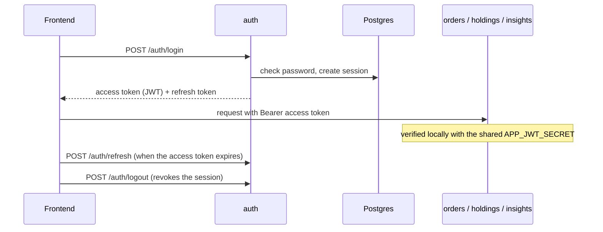

# Identity Service (auth)

NestJS service that registers TRADER and ANALYST accounts, signs users in, and
issues the tokens every NextTrade backend trusts. Sessions can be refreshed and
revoked (logout).

## How it works



- **Access token:** JWT (HS256) with `sub`, `email`, `user_role`, `client_id`, and
  `trader_level` for users with a trading account; at most 10 minutes. Backends verify it themselves and never call this service.
- **Refresh token:** random value, stored only as a SHA-256 hash in `sessions`;
  single use (each refresh replaces it).
- **10-minute inactivity timeout (BR-03):** a session expires 10 minutes after
  its last refresh (`SESSION_INACTIVITY_MINUTES`). The frontend refreshes in the
  background while the user is active and signs them out after 10 idle minutes.
  The BRS note proposes one minute; the reason for retaining ten minutes is
  recorded in the [NEXT-253 authentication policy decision](../docs/architecture/ADR-NEXT-253-authentication-policy.md).
- **Three-failure sign-in lockout (BR-03 / NEXT-253):** three consecutive wrong
  passwords lock the account for 15 minutes. Attempts during the lock cannot
  extend it. Once it expires, a new attempt is allowed; successful sign-in resets
  the counter. Wrong passwords, unknown emails and locked accounts receive the
  same `401 INVALID_CREDENTIALS` with a fixed message explaining the policy.
  Counters persist across Identity restarts. The development seed resets both
  `failed_login_attempts` and `locked_until` for the three demo accounts.
- Browsers reach the service only through the shared gateway at `/auth/*`
  (same origin, so no CORS; no public port in docker-compose).

## Endpoints

Full request/response schemas are in the **OpenAPI spec**, generated from the code:

- **Without running anything:** [`openapi.json`](openapi.json). For the interactive
  view, paste it into [editor.swagger.io](https://editor.swagger.io).
- **With the stack running:** Swagger UI at `/auth/docs` (e.g.
  `http://localhost:4200/auth/docs` via the gateway), raw spec at `/auth/docs-json`.

After changing an endpoint or DTO, run `npm run docs:openapi` to regenerate
`openapi.json`; a unit test fails while it's out of date.

| Method | Path | Body | Success | Errors |
|---|---|---|---|---|
| POST | `/auth/register` | role, email, password, profile fields | `201` user (no tokens) | `400`, `409` email exists, `422` below $5,000 capacity |
| POST | `/auth/login` | `email`, `password` | `200` tokens + user | `400`, `401` |
| POST | `/auth/refresh` | `refreshToken` | `200` new tokens | `400`, `401` |
| POST | `/auth/logout` | `refreshToken` | `204` | `400` missing token |
| POST | `/auth/forgot-password` | `email` | `202` always | `400` missing or malformed email |
| POST | `/auth/reset-password` | `token`, `newPassword` | `204` | `400` `INVALID_RESET_TOKEN`, `400` password breaks the 8-128 rule |
| PATCH | `/auth/me/profile` | `address` and/or `phone` (Bearer token) | `200` profile | `400`, `401`, `404` no profile |
| POST | `/auth/me/email` | `newEmail`, `currentPassword` (Bearer token) | `200` user | `400`, `401` `INCORRECT_PASSWORD`, `409` `EMAIL_IN_USE` |
| POST | `/auth/me/password` | `currentPassword`, `newPassword` (Bearer token) | `200` new token pair | `400`, `401` `INCORRECT_PASSWORD` |
| GET | `/rules/tier-eligibility` | — (Bearer token) | `200` tier, balance, gap to next tier | `401`, `404` no account |
| GET | `/health` | — | `200` | — |

**Trader tier (NEXT-152):** the server assigns `trader_level` at registration
from declared finances -- capacity = net-worth bracket lower bound + 10% of
annual income; `ADVANCED` at $100,000, `NOVICE` at $5,000, otherwise `422`.

**Account settings (PS-07):** the `/auth/me/*` routes act only on the caller named by the access token (BR-02). Changing email or password needs the current password; a wrong one returns `401 INCORRECT_PASSWORD`, changes nothing and counts toward the three-failure lockout. A new email must not belong to another account (`409 EMAIL_IN_USE`). A password change revokes every session and returns a fresh token pair for the caller, so only the other devices are signed out. Each change writes `PROFILE_UPDATED`, `EMAIL_CHANGED` or `PASSWORD_CHANGED` to `audit_log` with the changed field names only (never passwords, SSNs or contact values), and email and password changes send a notice (PS-08): to the old and new address for email, to the account for password.

**Logout** revokes only the session behind that refresh token; other devices
stay signed in. It returns `204` even for an unknown or already-revoked token,
so it can't be used to test whether a token is valid. The access token keeps
working until it expires (at most 10 minutes), so clients should discard it on logout.

**Password reset (TS-15.9):** `forgot-password` answers `202` whether or not the
email is registered. For a registered email it stores the SHA-256 hash of a random
32-byte token (one per user, so a new request cancels the old link), valid for 20
minutes, and emails the link. `reset-password` sets the new password (same rule as
registration), deletes the token and revokes every refresh token the user holds, in one
transaction, then emails a "password changed" notice. Raw tokens are never logged.

**Password expiry (BR-03):** a password is good for `PASSWORD_MAX_AGE_DAYS` (default 90)
from the moment it is set (`users.password_changed_at`, migration 019). Once an hour
(`PASSWORD_EXPIRY_SWEEP_MINUTES`) the service finds ACTIVE users whose password expires within
`PASSWORD_EXPIRY_WARNING_DAYS` (default 14) and emails each of them one "expires soon" notice,
recorded in `users.password_expiry_warned_at` and as `PASSWORD_EXPIRY_WARNED` in `audit_log`,
so restarts and a second instance never resend it. Changing or resetting the password restarts
the clock and the warning. Signing in with a correct but expired password is refused with
`403 PASSWORD_EXPIRED`; the service writes `PASSWORD_EXPIRED_SIGN_IN` to `audit_log` and emails
a one-time reset link, so the user can get back in from the email without a support call. A
wrong password for an expired account is still the generic `401`, so expiry never confirms an
account exists.

**Email (PS-08):** every email goes through one `MailDelivery` interface, chosen by
`MAIL_DELIVERY`. Emails are sent after the DB commit, and a failed send is logged, not
returned to the user.

| `MAIL_DELIVERY` | Where | What happens |
|---|---|---|
| `outbox` (default) | the VM, which has no network | one `.eml` file per email in `PASSWORD_RESET_OUTBOX_DIR`; in Compose that is the `password_reset_outbox` volume: `docker-compose exec auth sh -c 'cat /app/outbox/*.eml'` |
| `smtp` | dev laptops | sent to Mailpit (`SMTP_HOST`:`SMTP_PORT`, default `localhost:1025`); inbox at http://localhost:8025. With Docker: `docker compose -f docker-compose.yml -f docker-compose.dev.yml up -d`; without Docker, run the Mailpit binary |

The SMTP sender is a small client on Node's built-in `net` module (plain SMTP, no TLS or
login, which is all Mailpit needs), so the VM's image build needs no new npm package.

Errors are JSON with a fixed code (`INVALID_CREDENTIALS`, `USER_ALREADY_EXISTS`,
`INVALID_REFRESH_TOKEN`, `INVALID_RESET_TOKEN`, `INVALID_ACCESS_TOKEN`, `INSUFFICIENT_INVESTABLE_ASSETS`,
`ACCOUNT_NOT_FOUND`, `INVALID_REQUEST`, `INTERNAL_ERROR`); raw messages are
never returned, since requests can carry passwords and SSNs.

## Project structure

| Folder | What's in it |
|---|---|
| `src/main.ts`, `app.setup.ts`, `app.module.ts` | Startup: `/auth` prefix, security headers, validation, DB connection |
| `src/user/` | `auth.controller.ts` (the endpoints), `user.service.ts` (login), DTOs, exceptions |
| `src/onboarding/` | `registration.service.ts`: one transaction writing `users` plus the role's profile tables; `tier-rules.ts`: tier assignment |
| `src/rules/` | `GET /rules/tier-eligibility` |
| `src/password-reset/` | Forgot/reset password endpoints, token handling, and the reset/password-changed email texts |
| `src/mail/` | `MailDelivery`: the `.eml` outbox and the SMTP sender, picked by `MAIL_DELIVERY` |
| `src/docs/` | OpenAPI document and Swagger UI setup |
| `src/security/` | JWT signing, refresh tokens/sessions, bcrypt, SSN encryption (pgcrypto), optional TLS |
| `src/common/filters/` | Turns every error into a JSON response with a fixed code |
| `test/` | End-to-end suites against a real Postgres |

Entities map one-to-one to tables in `db/finalized-schema.sql`; the service
never creates or changes tables. Unit tests (`*.spec.ts`) sit next to the code.

## Configuration

Access tokens are bound to live sessions. See [immediate session revocation](../docs/immediate-session-revocation.md)
for the password-change behavior, service configuration and rollout requirements.

See the root [env.example](../env.example) for Compose settings. For a native process, supply these settings in its environment:

| Variable | Purpose |
|---|---|
| `DB_HOST`, `DB_PORT`, `DB_NAME`, `DB_APP_USERNAME`, `DB_APP_PASSWORD` | Postgres connection (restricted `app_user` role) |
| `APP_JWT_SECRET` | Shared with the backends; required in production, 32+ bytes |
| `SESSION_INACTIVITY_MINUTES` | Idle time before a session ends (default 10) |
| `APP_JWT_EXPIRATION_MINUTES` | Access token lifetime; can only be shorter than the inactivity window |
| `NEXTTRADE_SECURITY_SSN_ENCRYPTION_KEY` | Identity SSN encryption key; Compose maps `SSN_ENCRYPTION_KEY` to this setting |
| `TLS_KEYSTORE`, `TLS_KEYSTORE_PASSWORD` | Optional: serve HTTPS directly (unset behind nginx) |
| `MAIL_DELIVERY` | `outbox` (default) or `smtp`; anything else stops startup |
| `PASSWORD_RESET_OUTBOX_DIR` | Folder for `.eml` files when `MAIL_DELIVERY=outbox` (default `./outbox`) |
| `SMTP_HOST`, `SMTP_PORT` | SMTP server when `MAIL_DELIVERY=smtp` (default `localhost:1025`, a local Mailpit) |
| `MAIL_FROM` | From address (default `NextTrade <no-reply@nexttrade.local>`) |
| `PASSWORD_RESET_URL` | Reset page the emailed link opens (default `http://localhost:4200/reset-password`) |
| `PASSWORD_MAX_AGE_DAYS` | Days a password stays valid (default 90) |
| `PASSWORD_EXPIRY_WARNING_DAYS` | Days before expiry the one "expires soon" email goes out (default 14; must be below the maximum age) |
| `PASSWORD_EXPIRY_SWEEP_MINUTES` | How often to look for passwords entering that window (default 60; `0` turns the sweep off) |
| `PORT` | Default 8081 (internal in Compose) |

## Running it

```
npm ci
npm run start:dev      # needs a reachable Postgres
npm run build && npm run start:prod
```

## Testing

| What | Command |
|---|---|
| Unit tests (no database) | `npm test` |
| Code coverage | `npm run test:cov` |
| End-to-end tests | `npm run test:e2e` |

### Code coverage

```
npm run test:cov
```

Open `coverage/lcov-report/index.html` in a browser (Windows:
`start coverage\lcov-report\index.html`). Click a file to see untested lines in
red. The report is generated locally and is not committed.

The latest figures are in [docs/coverage](../docs/coverage/README.md); the end-to-end suite isn't included.

### End-to-end tests

They boot the real app against a Postgres with `db/finalized-schema.sql` and
`db/init-app-role.sh` applied (the `db` service in `docker-compose.yml` does
both). Host-run tests need a separately reachable disposable database; Compose does not publish PostgreSQL to the host by default. See [database setup](../docs/DATABASE_SETUP.md). `auth.e2e-spec.ts` runs over HTTPS and needs a keystore;
`behind-nginx.e2e-spec.ts` runs plain HTTP, as docker-compose does.

```
openssl req -x509 -newkey rsa:2048 -nodes -keyout key.pem -out cert.pem -days 1 -subj "/CN=localhost"
openssl pkcs12 -export -inkey key.pem -in cert.pem -out auth.p12 -passout pass:changeit

DB_HOST=localhost DB_APP_PASSWORD=... APP_JWT_SECRET=... NEXTTRADE_SECURITY_SSN_ENCRYPTION_KEY=... \
TLS_KEYSTORE=file:./auth.p12 TLS_KEYSTORE_PASSWORD=changeit npm run test:e2e
```

Each run creates its own test users and deletes them afterwards.
